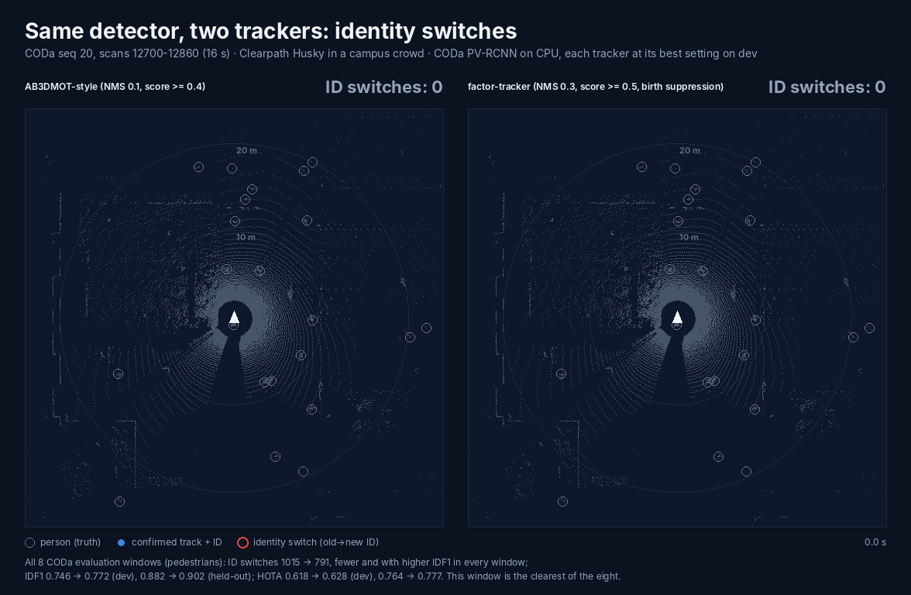
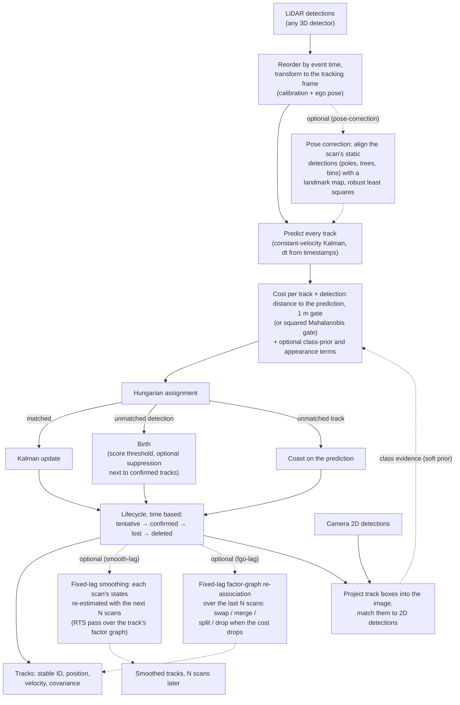
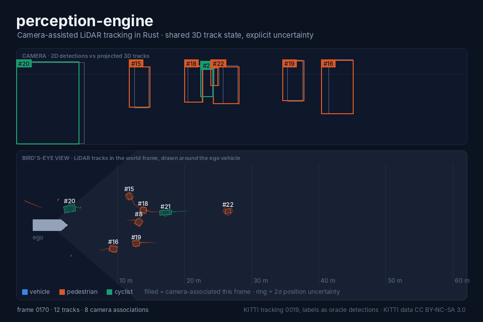
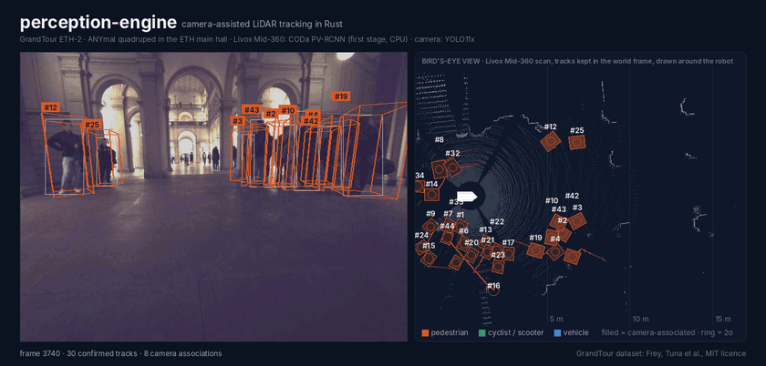

<p align="center">
  
</p>

<h1 align="center">Factor Graph Object Tracker</h1>

<p align="center"><code>factor-tracker</code></p>

<p align="center">
  <a href="https://github.com/rsasaki0109/factor-tracker/actions/workflows/ci.yml"></a>
  <a href="#license"></a>
  
  
</p>

<p align="center"><em>Same detector, two trackers, each at its best setting on dev (CODa seq 20, 16 s). Red rings: identity switches against CODa's labels. Arrows: estimated velocity, 2 s ahead; grey: from the labels.</em></p>

Multi-object tracking for robots in Rust: detections from any 3D detector in,
people (or other objects) with stable IDs, position, velocity and covariance
out. Kalman filtering and assignment per scan, with fixed-lag factor-graph
smoothing and ego-pose correction on top. CPU-only; the core library has
two dependencies (`nalgebra`, `thiserror`). A ROS 2 node and a
[browser demo](https://rsasaki0109.github.io/factor-tracker/) are included.

## Why factor-tracker

Measured with the same detections for every tracker (tables below):

- **Ahead of the nuScenes tracking-challenge winner on pedestrians**: AMOTA
  0.768 against 0.721 (Chiu et al., first place at NeurIPS 2019) on the
  held-out half of the validation split, official devkit, MEGVII detections;
  0.798 against 0.754 on the whole split.
- **Fewer identity switches** on CODa than an AB3DMOT-style tracker: 773 vs
  987 on the development windows (562 with pose correction), 18 vs 28 on the
  held-out ones.
- **About 25-30 % better velocities with 0.5 s smoothing** (`--smooth-lag 5`):
  each scan is re-estimated with the next five, which also raises HOTA. The
  ROS 2 node publishes both: `tracks` at once, `tracks/smoothed` 0.5 s later.
- **Robust to jittery ego poses** (`--pose-correction`): each scan is aligned
  with the static objects the detector also reports (poles, trees, bins).
  With 1° / 0.1 m of pose noise added, HOTA stays at 0.631 dev / 0.767
  held-out; without it the tracker drops to 0.538 / 0.688 (AB3DMOT-style
  0.514 / 0.649).
- **Drop-in**: any detector, any frame with TF (ROS 2), no GPU, deterministic
  replay of recorded detections for evaluation.

## Results

### nuScenes (standard benchmark)

Pedestrians on the nuScenes validation split with the MEGVII detections
(nuScenes' official tracking baseline input), scored by the official devkit.
factor-tracker's settings were chosen on half of the scenes and the other
half scored once; Chiu et al. ran with their published setting.

| tracker | held-out half AMOTA | AMOTP (m) | recall | MOTA | ID switches | whole split AMOTA |
| --- | --- | --- | --- | --- | --- | --- |
| AB3DMOT (official baseline results) | 0.109 | 1.738 | 0.242 | 0.135 | 448 | 0.094 |
| Chiu et al. (challenge winner, NeurIPS 2019) | 0.721 | 0.570 | 0.780 | 0.622 | 143 | 0.754 |
| **factor-tracker** | **0.768** | **0.417** | **0.804** | **0.643** | **124** | **0.798** |

The detections' velocities are used as measurements (`--velocity-std`).
Reproduction and the tuning steps: [`docs/evaluation.md`](docs/evaluation.md).

### CODa (robot)

Pedestrian tracking on 8 CODa windows, **same detector for every tracker**
(CODa PV-RCNN first stage on CPU). Velocity: median error against the
labels.

| tracker | detections (NMS IoU, score) | dev HOTA | dev IDF1 | dev ID switches | dev velocity (m/s) | held-out HOTA | held-out IDF1 | held-out ID switches | held-out velocity (m/s) |
| --- | --- | --- | --- | --- | --- | --- | --- | --- | --- |
| Kalman + Mahalanobis gate | 0.1, >= 0.4 | 0.600 | 0.722 | 1151 | 0.224 | 0.745 | 0.888 | 22 | 0.129 |
| AB3DMOT-style | 0.1, >= 0.4 | 0.618 | 0.746 | 987 | 0.227 | 0.764 | 0.882 | 28 | 0.133 |
| factor-tracker | 0.3, >= 0.5 | 0.628 | 0.772 | 773 | 0.218 | 0.777 | 0.902 | **18** | 0.129 |
| + 0.5 s smoothing | 0.3, >= 0.5 | 0.638 | 0.773 | 767 | 0.155 | **0.782** | 0.905 | **18** | **0.099** |
| **+ 0.5 s smoothing + pose correction** | 0.3, >= 0.5 | **0.640** | **0.793** | **562** | **0.153** | 0.774 | **0.908** | **18** | 0.102 |

factor-tracker runs with distance association and no new track within 0.8 m
of a confirmed one, which absorbs the duplicate boxes of the looser NMS.
Each tracker uses the detection setting that is best for it on dev (5
windows); held-out (3 windows) was scored once per setting. Pose correction
helps where the given poses jitter (two dev windows) and costs a little where
they are clean (held-out). The detector was trained on most of these scans,
so absolute numbers are optimistic for every tracker. Details:
[`docs/evaluation.md`](docs/evaluation.md).

## How it works

Per LiDAR scan (details: [`docs/algorithms.md`](docs/algorithms.md),
[`docs/camera-lidar.md`](docs/camera-lidar.md)):



## Demos

<p align="center">
  
</p>
<p align="center"><em>Camera + LiDAR on a wheeled robot (CODa seq 20, Ouster OS1-128).</em></p>

<p align="center">
  
</p>
<p align="center"><em>Livox Mid-360 + camera on a quadruped (GrandTour ETH-2); see <a href="docs/mid360.md"><code>docs/mid360.md</code></a>.</em></p>

## Quick start

```sh
cargo run -p factor-tracker -- demo --out-dir demo-out        # synthetic 2D/3D tracking + HTML views
cargo run -p factor-tracker -- cam-demo --out-dir cam-out     # camera + LiDAR pipeline + report
```

Rust 1.89 or newer. More: [`docs/usage.md`](docs/usage.md) (CLI, Rust API,
SDK), [`ros2/`](ros2/factor_tracker_ros) (ROS 2 node), [live browser demo](https://rsasaki0109.github.io/factor-tracker/)
(phone camera, source in [`web/`](web)).

## Documentation

- [`docs/usage.md`](docs/usage.md): CLI, Rust API, input/output, algorithm overview
- [`docs/architecture.md`](docs/architecture.md): design, scope, assumptions, limitations, references
- [`docs/algorithms.md`](docs/algorithms.md), [`docs/data-format.md`](docs/data-format.md), [`docs/camera-lidar.md`](docs/camera-lidar.md)
- [`docs/datasets.md`](docs/datasets.md), [`docs/evaluation.md`](docs/evaluation.md), [`docs/detector_training.md`](docs/detector_training.md)
- [`ROADMAP.md`](ROADMAP.md)

## License

Code: MIT OR Apache-2.0, at your option ([LICENSE-MIT](LICENSE-MIT),
[LICENSE-APACHE](LICENSE-APACHE)). The animations contain dataset images:
CODa ([CC BY-NC-SA 4.0](https://creativecommons.org/licenses/by-nc-sa/4.0/),
Zhang et al.) and [GrandTour](https://grand-tour.leggedrobotics.com) (MIT).
